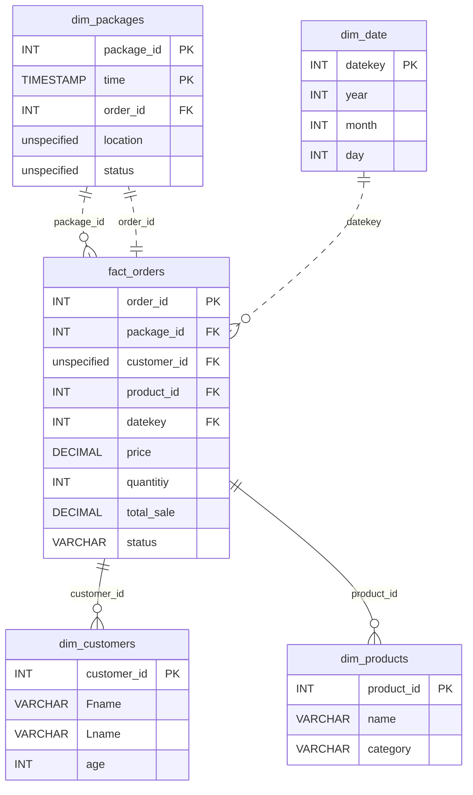

# The Last Mile

*Order placed. Now track it to the door.*

[Data Modeling · Medium · on DataDriven](https://datadriven.io/problems/the_last_mile)

## How it went

| | |
|---|---|
| Solved | 2026-10-19 |
| Accepted | on the first submission |
| Hints | none |
| Concepts | Attributes, Data Types, Dimension Tables, Entities, Fact Tables, Foreign Keys, Grain Definition, One-to-Many, Primary Keys, Snowflake Schema |

## The design

The accepted design is in [`schema.sql`](./schema.sql) as DDL and in [`schema.json`](./schema.json) as JSON.
